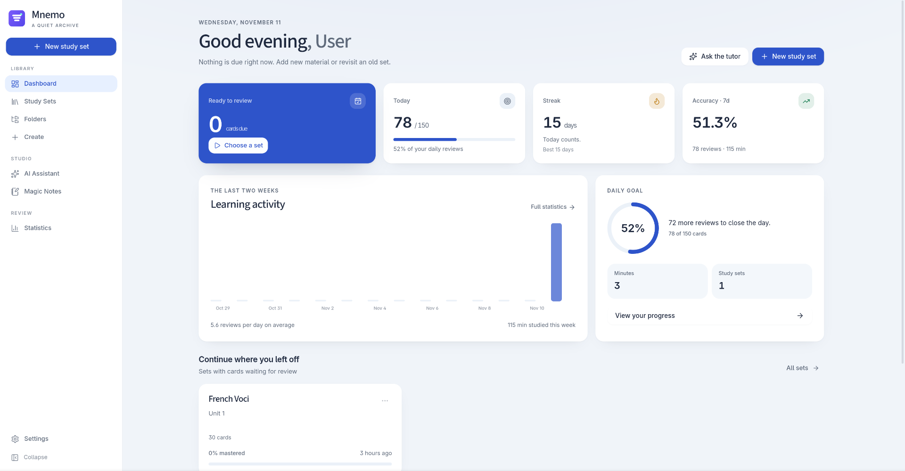
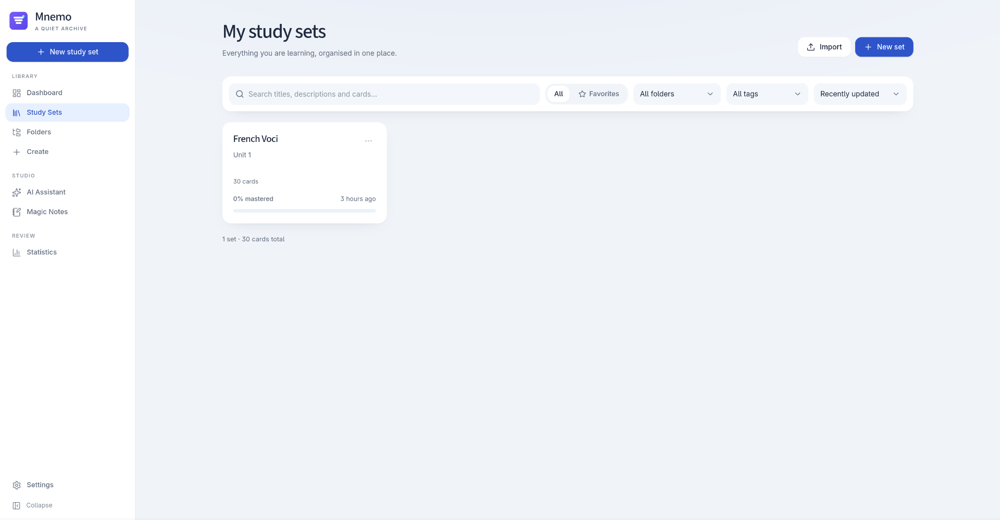
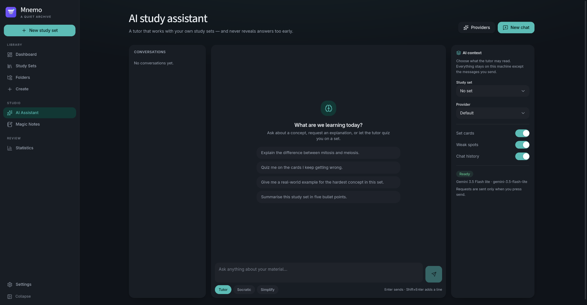
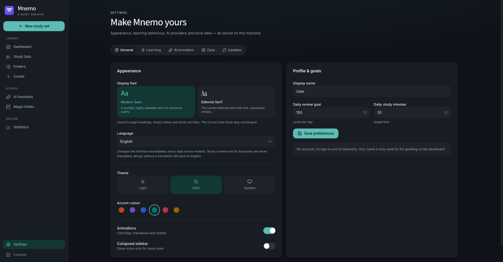

<p align="center">
  
</p>

<h1 align="center">Mnemo</h1>

<p align="center"><strong>A quieter way to remember.</strong></p>

<p align="center">
  A local-first desktop study app for flashcards, spaced repetition and deliberate practice.<br>
  Windows and Linux · optional AI · no account required
</p>

---

Mnemo keeps your study library on your own computer. It combines a native Tauri shell with a focused React interface, stores material in a local SQLite database, and treats AI assistance as an optional extra rather than a dependency.

There is no account system, no telemetry and no vendor-hosted service. AI features call only the provider you configure, and everything else works offline.

## Preview

Mnemo uses a calm, card-based dashboard: a soft neutral canvas, white surfaces with rounded corners and soft elevation, a cobalt accent and a full-height navigation rail that collapses to an icon strip. Modern Sans is the default typeface, with the editorial serif still available in Settings. Light and dark themes share the same structure, and the interface adapts from smaller laptop windows to large desktop screens. The token system, sidebar and startup rules are documented in [`docs/DESIGN.md`](docs/DESIGN.md).

<p align="center">
  
</p>

<table>
  <tr>
    <td width="50%" align="center"></td>
    <td width="50%" align="center"></td>
  </tr>
  <tr>
    <td colspan="2" align="center"></td>
  </tr>
</table>

Screenshots use neutral sample content from a development profile and show both themes. Requirements for new captures are documented in [`docs/screenshots/README.md`](docs/screenshots/README.md). Please do not add screenshots containing real study content, personal names, API keys or machine-specific paths.

## Features

- **Library management** — folders, tags, favourites, search, sorting, duplication, archiving and progress reset.
- **Rich cards** — front and back text, explanations, hints, images and audio attachments.
- **Starred terms and flashcard options** — star individual terms, start a session with the front or back side first, limit it to starred terms, and preview a real card directly on the set page.
- **Study modes** — flashcards, adaptive learning, writing practice, SM-2 spaced repetition, practice tests and a matching game.
- **Insights** — due counts, daily goals, timezone-stable current and longest streaks, activity ranges, a 30-week heatmap and per-set progress.
- **Import and export** — CSV, TSV, JSON and Quizlet-style text import; CSV, TSV, JSON, Markdown and PDF export.
- **Optional AI** — card generation, document summaries, study guides and tutor chat through OpenAI-compatible APIs, Gemini or local Ollama. Imported documents can be selected or removed individually.
- **Application info** — the installed version and a repository link are available at the bottom of Settings.
- **Automatic updates** — signed in-app updates for Windows x64 and Linux x86_64 AppImage builds, with stable and pre-release channels.
- **Privacy by default** — local SQLite storage, encrypted provider keys and no analytics.
- **English and German UI** — a language dropdown in Settings applies immediately and persists across restarts, with locale-aware dates, plural forms and bundled offline fonts.

## Supported platforms

| Platform | Status | Distribution | Automatic updates |
| --- | --- | --- | --- |
| Windows 10/11 x64 | Supported | NSIS installer (`.exe`) | Yes, in-app |
| Linux x86_64 (Flatpak) | Supported | Flatpak bundle (`com.mnemo.study`) | Yes, by Flatpak |
| Linux x86_64 (general) | Supported | AppImage | Yes, in-app |
| Linux x86_64 (Arch) | Supported | `.pkg.tar.zst` | Package manager only |
| Linux aarch64 | Not officially released | Source build may work; no package is published | No |
| macOS | Not supported | — | No |

Windows builds are produced on `windows-latest` in GitHub Actions. Linux checks, the AppImage, the Flatpak bundle and the Arch package are built on Linux runners. No macOS artifact is published. Debian packages are no longer built or distributed; Flatpak is the package-managed Linux format.

## Download and installation

Download the latest artifacts from the repository's **Releases** page. Generated packages are never committed to the repository.

### Windows 10 and 11

1. Download `Mnemo_<version>_x64-setup.exe`.
2. Run the installer. It installs for the current user, so administrator rights are not normally required.
3. Launch **Mnemo** from the Start Menu or the installer's finish page.

The installer adds a Start Menu entry, uses the Mnemo application icon and registers an uninstaller. Uninstall from **Settings → Apps → Installed apps → Mnemo**, or from the Start Menu shortcut's context menu.

The installer embeds the Microsoft WebView2 bootstrapper. Windows 11 and current Windows 10 installations normally already have WebView2. If it is missing, the installer downloads it from Microsoft during installation; that step requires an internet connection. No Rust, Node.js, pnpm or other development tools are required to install or run Mnemo.

> **Windows code signing:** the current installer is **not code-signed**. Windows SmartScreen may show an "Unknown publisher" warning. Verify that you downloaded the file from this repository's Releases page. Signing may be added in a future release; unsigned artifacts are never presented as signed.

### Arch Linux

```bash
sudo pacman -U mnemo-<version>-1-x86_64.pkg.tar.zst
```

The package installs the binary, desktop entry, hicolor icons and license notices.

### AppImage

```bash
chmod +x Mnemo_<version>_amd64.AppImage
./Mnemo_<version>_amd64.AppImage
```

The AppImage needs FUSE 2. If FUSE is unavailable, run it with:

```bash
./Mnemo_<version>_amd64.AppImage --appimage-extract-and-run
```

### Automatic updates

Mnemo updates itself in place on **Windows x64 NSIS installations** and **Linux x86_64 AppImages** downloaded from this repository's GitHub Releases. The **Flatpak** is updated by Flatpak itself, and the **Arch package** is left to pacman; neither is modified by the in-app updater.

Open **Settings → Updates** to choose a channel:

- **Stable Releases** (default) only considers GitHub releases that are not marked as pre-releases.
- **Pre-Releases** also considers beta and test releases. It never switches the channel automatically.

Checks run in the background at startup without blocking the app. If a compatible update is found, a dismissible notification appears in the bottom-right corner. Mnemo downloads and installs only after **Download and install** is selected, verifies the Tauri signature, and then restarts on Linux or lets the NSIS installer relaunch the Windows app. A failed check or installation leaves the current installation usable.

| Format | How updates are delivered | In-app updater |
| --- | --- | --- |
| Windows NSIS (`.exe`) | Tauri updater downloads the signed installer from GitHub Releases, then the NSIS installer relaunches Mnemo | Active |
| Linux AppImage | Tauri updater downloads and replaces the signed AppImage from GitHub Releases, then Mnemo restarts | Active |
| Linux Flatpak | Flatpak updates the installation from the remote it came from (Flathub once published), triggered by `flatpak update`, a software centre or the Flatpak background updater | Inactive by design; the Flatpak build reports that Flatpak owns updates |
| Arch package | pacman, from the package recipe | Inactive; the Arch build reports that the package manager owns updates |

Only one updater is ever active in a build. The Flatpak never calls the Tauri updater, so it cannot offer an update that would replace the sandboxed binary with an AppImage, and users see a single update notification from Flatpak rather than two competing ones.

Update signing uses Tauri's minisign key. The public key is embedded in `src-tauri/tauri.conf.json`; the encrypted private key and its password are GitHub Actions secrets named `TAURI_SIGNING_PRIVATE_KEY` and `TAURI_SIGNING_PRIVATE_KEY_PASSWORD`. Unsigned or tampered update payloads are rejected. Do not publish a release whose updater artifacts are missing signatures.

### Flatpak

Mnemo ships a self-contained Flatpak with the application ID `com.mnemo.study`, built against the GNOME 51 runtime and the Flathub conventions. It is **not yet published on Flathub**; until the submission is accepted, install the bundle that is attached to each release:

```bash
flatpak install --user ./Mnemo_<version>_x86_64.flatpak
flatpak run com.mnemo.study
```

The bundle references Flathub as its runtime source, so Flatpak downloads the GNOME 51 runtime on first install. Update the installed application with:

```bash
flatpak update com.mnemo.study
```

A software centre such as Discover or GNOME Software performs the same update, and repeating the `flatpak install` command above with a newer bundle also works. Flatpak keeps the sandbox and the application data in place across updates.

Inside the sandbox, imports, exports, backups and restores go through the desktop portals: the file chooser can read and write the files you pick without granting Mnemo access to your home directory. Mnemo's data lives in `~/.var/app/com.mnemo.study/data/com.mnemo.study/`.

## Getting started

1. Launch Mnemo. A new, empty library is created on first start; no demo data is inserted.
2. Create a study set, or import one from CSV, TSV, JSON or plain text.
3. Add cards with front/back text, an explanation, a hint and optional media.
4. Choose a study mode and start learning. Flashcards and keyboard shortcuts work without any AI configuration.
5. Open **Settings → Data** to see the exact database, media and backup locations on your machine.

Backups created from Settings are ordinary SQLite copies. They are **not encrypted**; store them somewhere you trust.

## AI configuration

AI is optional. Without a provider, the library, import/export, flashcards, spaced repetition, tests, statistics and backups all work normally.

1. Open **Settings → AI providers → Add provider**.
2. Select a preset or **Custom**.
3. Enter the base URL and model.
4. Paste your own API key. For local Ollama, leave the key empty.
5. Test the connection and optionally mark the provider as default.

| Provider type | Example base URL |
| --- | --- |
| OpenAI | `https://api.openai.com/v1` |
| OpenRouter | `https://openrouter.ai/api/v1` |
| Mistral | `https://api.mistral.ai/v1` |
| Gemini | Google Gemini API endpoint |
| Ollama (local) | `http://localhost:11434/v1` |
| Custom OpenAI-compatible | Your provider's `/v1` endpoint |

Provider keys are encrypted at rest with AES-256-GCM. The master key stays on the local machine: on Linux it is written with mode `0600`; on Windows it is protected with the current user's DPAPI credentials. Keys are never sent to the frontend or written to logs.

AI requests are sent directly to the provider you choose, under that provider's privacy terms. Mnemo does not proxy them through a project-operated server.

## Privacy and local data

Mnemo has no accounts, telemetry, analytics, cloud sync or bundled API keys. The application creates its own data directory on first launch.

| Data | Default location |
| --- | --- |
| Linux data directory | `$XDG_DATA_HOME/com.mnemo.study/` or `~/.local/share/com.mnemo.study/` |
| Linux data directory (Flatpak) | `~/.var/app/com.mnemo.study/data/com.mnemo.study/` |
| Windows data directory | `%APPDATA%\com.mnemo.study\` |
| Database | `<data dir>/mnemo.db` (SQLite, WAL mode) |
| Media attachments | `<data dir>/media/` |
| API-key vault | `<data dir>/secure.key` |
| Development builds | `<data dir>/dev/` |

On Linux, `secure.key` is created with `0600` permissions. On Windows, the file is wrapped with DPAPI and can only be decrypted by the same Windows user profile. Moving the data directory to another Windows account requires removing `secure.key` and re-entering provider keys; the database and study content are unaffected.

To remove all local data, quit Mnemo and delete its data directory. Uninstalling the application does not delete the data directory automatically.

## System requirements

- **Windows:** Windows 10 or Windows 11, x64, Microsoft WebView2 Runtime (installed automatically if missing and an internet connection is available).
- **Linux (Flatpak):** Flatpak 1.12 or newer and a desktop portal (shipped by GNOME, KDE and every major desktop). The runtime supplies WebKitGTK 4.1, GTK 3, libsoup 3 and GStreamer, so no distribution packages are required.
- **Linux (AppImage):** x86_64 distribution with WebKitGTK 4.1, GTK 3 and libsoup 3, plus FUSE 2.
- A local SQLite-capable filesystem. Network shares are not recommended for the live database.
- AI features require network access to the configured provider. Ollama can run entirely locally.

## Development and build

### Requirements

- Rust stable (MSVC toolchain on Windows)
- Node.js 22 LTS or newer
- pnpm **12.18.0** (also declared in `package.json`)
- Windows: Visual Studio Build Tools with the **Desktop development with C++** workload and WebView2
- Linux: WebKitGTK 4.1, GTK 3, libsoup 3 and the usual Tauri build dependencies

Install the Linux dependencies on Debian/Ubuntu:

```bash
sudo apt install libwebkit2gtk-4.1-dev libgtk-3-dev libsoup-3.0-dev \
  libayatana-appindicator3-dev librsvg2-dev patchelf build-essential \
  curl file pkg-config
```

On Arch Linux:

```bash
sudo pacman -S webkit2gtk-4.1 gtk3 libsoup3 librsvg patchelf base-devel
```

On Windows, install [Rust](https://rustup.rs/), Node.js 22 and pnpm, then make sure the MSVC Rust toolchain is active:

```powershell
rustup default stable-msvc
corepack enable
corepack prepare pnpm@12.18.0 --activate
```

### Run locally

```bash
git clone https://github.com/SnifferLP/Mnemo.git
cd Mnemo
pnpm install --frozen-lockfile
pnpm tauri dev
```

Vite serves the UI on `http://127.0.0.1:1420`; Tauri opens the native window. Development builds use a separate `dev` data directory so they cannot modify an installed library.

### Build installers

```bash
pnpm tauri build
```

On Linux this produces an `.AppImage` under `src-tauri/target/release/bundle/appimage/`; the Debian bundle target has been removed. On Windows, `src-tauri/tauri.windows.conf.json` selects NSIS and produces an installer under `src-tauri/target/release/bundle/nsis/`.

The Flatpak is not a Tauri bundle target. It is built from `packaging/flatpak/com.mnemo.study.yml` with `flatpak-builder`; see [`packaging/flatpak/README.md`](packaging/flatpak/README.md) for the manifest, the runtime and the bundle command.

These ordinary builds do **not** produce updater signatures. To build signed updater artifacts locally, set `TAURI_SIGNING_PRIVATE_KEY` and `TAURI_SIGNING_PRIVATE_KEY_PASSWORD`, then merge the release config:

```bash
pnpm tauri build --config src-tauri/tauri.release.conf.json
```

On Linux this adds `Mnemo_<version>_amd64.AppImage.sig`; on Windows it adds `Mnemo_<version>_x64-setup.exe.sig`. Release automation generates the platform manifest as `latest.json` and attaches it to the GitHub Release.

### Arch Linux packaging

Build the release binary without Tauri's own Linux bundles, then create the Arch package:

```bash
pnpm tauri build --no-bundle
./packaging/arch/build-binary-package.sh
```

See [`packaging/arch/README.md`](packaging/arch/README.md) and [`docs/RELEASING.md`](docs/RELEASING.md) for source-package and release details.

## Tests

Run the same checks locally that CI runs:

```bash
pnpm typecheck
pnpm test
pnpm build

cd src-tauri
cargo fmt --all --check
cargo clippy --all-targets --all-features -- -D warnings
cargo test --all-targets
```

The current local suite contains **33 Rust unit tests**, **15 Rust integration tests** and **56 frontend tests**. The frontend suite covers learning-round state, activity-chart axis helpers, flashcard option helpers, card-duplicate matching, settings merging, automatic-update defaults, motion preferences, update-channel persistence and translation catalogues. Rust tests cover SM-2 scheduling, answer normalization, import/export, AI request construction, settings sanitization, database migrations, CRUD, document removal, updater channel selection, statistics, persistence, starred terms, archive round trips and upgrade behavior.

GitHub Actions also runs the Rust suite on Windows, builds the NSIS installer, builds the Linux AppImage and Flatpak bundles and builds the Arch package. A successful compile is not a substitute for manual testing of Windows installation, display scaling, audio playback and other interactive behavior; see [`docs/RELEASING.md`](docs/RELEASING.md) for the manual QA checklist.

## License and third-party licenses

Mnemo's source code is released under the **MIT License**; see [`LICENSE`](LICENSE).

Bundled fonts are licensed separately under the **SIL Open Font License 1.1**. Third-party components, including `windows-sys`, Tauri, React and cryptography crates, are documented in [`THIRD_PARTY_NOTICES.md`](THIRD_PARTY_NOTICES.md). The MIT license does not replace those terms.

## Reporting bugs and getting support

- Search existing issues before opening a new one.
- Use the [bug report template](.github/ISSUE_TEMPLATE/bug_report.yml) and include the Mnemo version, platform, steps to reproduce and relevant logs with secrets and personal data removed.
- For suspected security vulnerabilities, follow [`SECURITY.md`](SECURITY.md) and use the repository's private **Report a vulnerability** flow. Do not open a public issue for a vulnerability.
- Feature requests and general questions are welcome through the repository's issue tracker.

When reporting a Windows problem, please state whether it occurs with the installed NSIS build or a local development build, and whether WebView2 is installed.

## Known limitations

- No cloud sync, sharing links, mobile app or multi-user accounts.
- The Windows installer is currently unsigned. Updater artifacts are separately signed with Tauri's update key and are not affected by Windows Authenticode status.
- Automatic updates are not implemented for the Flatpak or the Arch package. Flatpak updates its own installations and pacman owns the Arch package.
- The Flatpak is prepared for Flathub but not published there yet; until then it is installed from the bundle attached to each release.
- AI quality and availability depend on the configured provider; AI grading is off by default and consumes provider tokens.
- Scanned PDFs require external OCR.
- PDF export uses a limited built-in font encoding; use JSON or Markdown for full Unicode.
- Tests and study material are stored locally without a separate answer-key permission model; Mnemo is a single-user desktop application.
- macOS is not supported.
